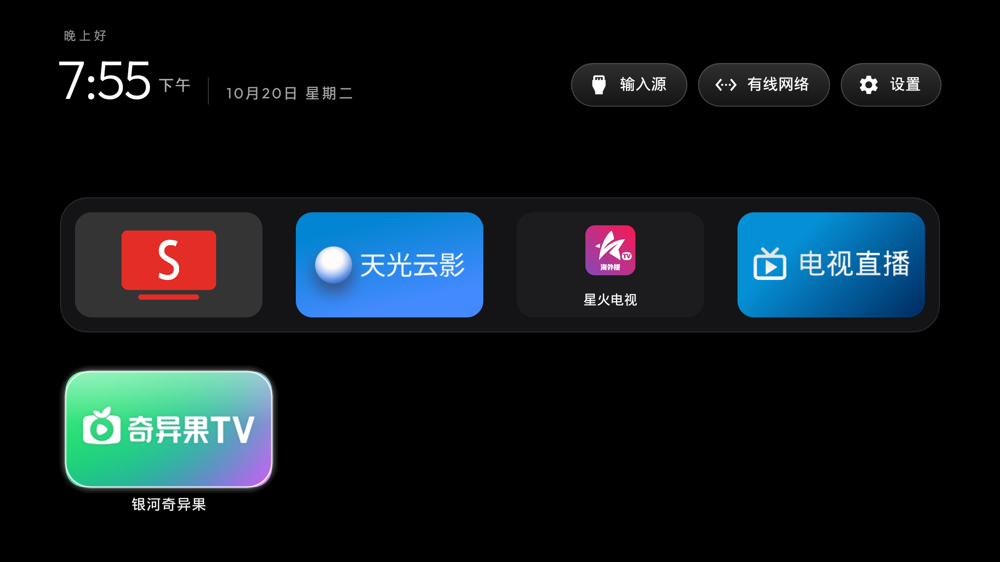

# TV Desktop

面向 Android TV、Google TV 和兼容安卓电视的轻量桌面：没有广告推荐流，使用遥控器即可打开应用、切换输入源、进入网络和系统设置。不仅限于 Sony，也可用于其他品牌的兼容安卓电视。

- 源码与反馈：[zzusec/tv-desktop](https://github.com/zzusec/tv-desktop)
- APK 下载与校验文件：[Releases](https://github.com/zzusec/tv-desktop/releases/latest)
- 旧系统适配与实测记录：[docs/OLD-TVS.md](docs/OLD-TVS.md)

## 界面截图



Sony BRAVIA 4K 2015 / Android 7 实机截图。应用图标与排列取决于电视上安装的应用和个人设置，截图中的第三方应用不随本软件提供。

## 适用范围与功能

- Android 4.4 / API 19 起可安装；不适用于 Tizen、webOS 或其他非安卓系统。Fire TV 等限制第三方 HOME 的系统不能据此保证可接管桌面。
- 本分支已在 Sony BRAVIA 4K 2015 / Android 7 实机验证。Android 4.4 与其他品牌/固件仍需分别验证，不能把上游机型资料视为本分支逐台实测结果。
- 应用 dock、网格、输入源、网络状态、主题和遥控器焦点导航；可调节低性能设备的动效。
- 长按应用图标的 OK 可隐藏图标；长按顶部设置的 OK → 简洁桌面设置 → 隐藏的应用，可恢复图标。只隐藏桌面入口，不停用或卸载应用。
- 压缩顶部过大的动态留白，兼容旧系统字体与图标显示。
- 保留应用内正常返回；应用退出后回到默认桌面，不把返回键全局映射为 Home。应用自己的退出确认仍保留，个别应用的自定义返回行为需要单独验证。

## 下载与安全预览

从 Releases 下载 `tv-desktop-2.5.apk` 和 `SHA256SUMS`，先核对 SHA-256。当前 APK 的应用内版本仍为 2.5 / versionCode 6，包名保留为 `com.gathin.tvhome`，以保持现有配置与升级兼容；仓库名称不等于 Android 包名。

在电视开启 USB / 网络调试，并允许你自己电脑的调试授权。先保留原厂桌面，只安装并打开预览：

```bash
TV=192.168.1.50:5555  # 替换为你自己的电视地址
adb connect "$TV"
adb -s "$TV" install -r tv-desktop-2.5.apk
adb -s "$TV" shell am start -n com.gathin.tvhome/.MainActivity
```

这几条命令不会停用原厂桌面，也不会自动设置默认 HOME。确认显示、遥控器、设置入口正常后，再使用该固件支持的默认桌面设置；并非所有电视都会提供相同入口。

**不要直接套用停用清单，不要卸载唯一可用的桌面。** 如确需停用原厂桌面，必须先核对实际包名、备份、演练恢复，并设置独立的定时回退；原厂桌面已经停用时，升级 APK 前也必须有回退保护。断电重新上电和无需 ADB 的遥控器独立救援尚未在上述 Sony 设备上验证。

发布 APK 当前使用调试证书签名，供 ADB 侧载验证。自行构建会使用你本机的调试签名，不一定能覆盖安装已有版本；不要为解决签名冲突而贸然卸载正在使用的唯一桌面。ADB 私钥、签名私钥和设备备份不随源码发布。

## 从源码构建

### 独立 ADB 诊断助手

另提供适配 Android 4.4 起的 [TV ADB 助手](launcher/adb-helper/README.md)：支持遥控器操作，检查调试属性、进程及本机 ADB 协议，提供受系统权限约束的开启尝试。它不替换桌面，也不能绕过权限保证开启 ADB；可通过 U 盘安装。下载及限制见该模块说明。

### 桌面与助手构建

需要 JDK 17、Android SDK platform 34 和 build-tools 34.0.0；Gradle Wrapper 已包含在仓库中。

```bash
git clone https://github.com/zzusec/tv-desktop.git
cd tv-desktop/launcher
./gradlew assembleRelease lintRelease testReleaseUnitTest --console=plain
cd ..
CLEANYOURTV_STRICT=1 python3 -m unittest discover -s tests -v
```

APK 位于 `launcher/app/build/outputs/apk/release/app-release.apk`。`JAVA_HOME` 和 `ANDROID_HOME` 应指向你本机的 JDK 与 SDK，不要提交 `launcher/local.properties`、ADB key、keystore 或电视状态备份。

桌面模块通过 64 项 JVM、仓库 18 项 Python、release 构建与 lint；独立 ADB 助手另通过 21 项 JVM、构建和 lint，但尚待电视端实机安装验证。lint 仍有警告。CI 同时检查构建、测试和桌面 450 KiB 的 APK 体积预算。发现问题时请附机型、Android/固件版本和复现步骤，不要公开令牌、序列号或 ADB 密钥。

## 许可与来源

本项目基于 [Gathin23/CleanYourTV](https://github.com/Gathin23/cleanyourtv)，保留原作者署名和 Git 历史，以 [MIT](LICENSE) 协议开源；不是 Sony 或其他电视厂商的官方产品。字体采用独立的 [SIL Open Font License](launcher/FONT-LICENSE-OFL.txt)。
